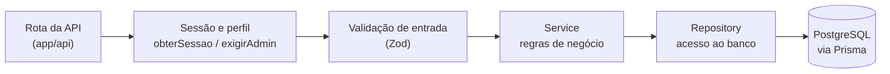
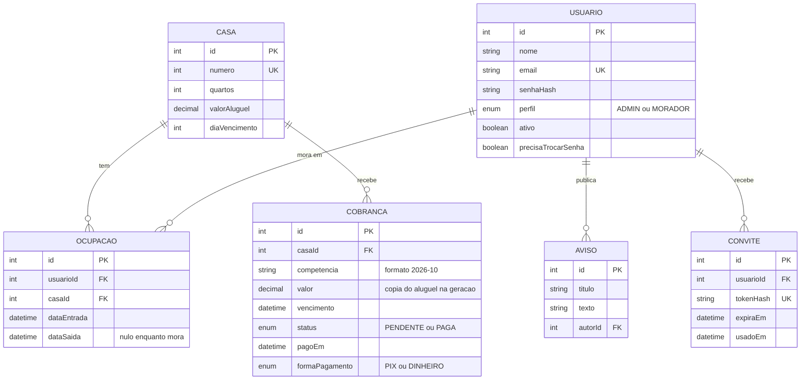
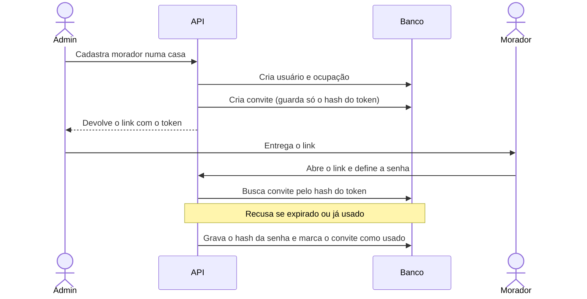

# Arquitetura

Este documento complementa o [README](../README.md) com o modelo de dados, as camadas do código, as regras de negócio e o fluxo do convite.

## Camadas

O código separa o que recebe a requisição, o que decide e o que acessa o banco. Assim, as regras de negócio não ficam espalhadas pelas rotas e podem ser testadas sem subir o servidor.

| Camada | Pasta | Responsabilidade |
| ------ | ----- | ---------------- |
| Rotas e telas | `app/` | Receber a requisição, identificar quem pede e devolver a resposta |
| Sessão e autorização | `lib/` | `obterSessao()` identifica o solicitante e confere no banco se ele está ativo; `exigirAdmin()` barra quem não é admin |
| Validação | `validators/` | Schemas Zod para tudo o que entra |
| Regras de negócio | `services/` | Decisões do sistema (ex.: admitir e desligar morador) |
| Acesso a dados | `repositories/` | Consultas Prisma, sem regra de negócio |
| Erros | `errors/` | `AppError`, um erro de domínio que carrega o status HTTP (401, 403 etc.) |

## Modelo de dados

### Decisões de modelagem

- **A casa não guarda se está ocupada.** O status é calculado a partir das ocupações, para não existir uma segunda fonte de verdade que poderia ficar inconsistente.
- **A ocupação preserva cada período de residência** (`dataEntrada`, `dataSaida`). É ela que permite ao admin ver o histórico completo e ao morador ver só o próprio período. As chaves estrangeiras usam `onDelete: Restrict`, então não é possível apagar um usuário ou uma casa que tenha histórico.
- **A cobrança pertence à casa**, não ao morador. Ela não tem ligação direta com o usuário: quem a enxerga é decidido pelo período da ocupação.
- **O valor da cobrança é uma cópia** do aluguel da casa no momento da geração. Reajustar o aluguel não altera as cobranças antigas.
- **Admin e morador ficam na mesma tabela**, separados pelo campo `perfil`, o que permite um login único.
- **O convite guarda só o hash do token** (`tokenHash`), nunca o token em si. Quem tiver acesso ao banco não consegue montar um link de convite válido.
- **Índices** em `Ocupacao` (`usuarioId` e `casaId` com as datas) servem às consultas por período, que são as mais frequentes.

## Regras de negócio

- **As 20 casas são criadas por seed.** Não existe rota para criar ou apagar casa.
- **Uma cobrança por casa e competência.** A chave única `(casaId, competencia)` impede duplicidade no banco, mesmo que a rotina mensal rode mais de uma vez.
- **O morador só vê cobranças cujo vencimento cai dentro de uma ocupação dele.** O admin vê todas.
- **Um morador não pode ter duas ocupações ativas ao mesmo tempo.** Essa regra vive no service e tem teste; o schema, sozinho, não a impõe.
- **Um usuário desativado (`ativo = false`) perde o acesso imediatamente**, porque a sessão é conferida no banco a cada requisição.
- **O pagamento é registrado manualmente pelo admin**, que informa a forma (`PIX` ou `DINHEIRO`); o sistema grava `pagoEm` e muda o status para `PAGA`.
- **Avisos são publicados apenas pelo admin**, e cada aviso guarda o autor.

## Fluxo do convite

O admin cadastra o morador, mas quem escolhe a senha é o próprio morador, por um link de uso único.

O token aparece em claro só no momento da criação, para ser entregue ao morador. Depois disso, só o hash fica no banco, e o convite deixa de valer ao ser usado ou ao expirar.

## Possíveis evoluções do modelo

- **Mais de um condomínio:** criar a entidade `Condominio` ligada às casas e filtrar toda consulta e toda autorização por ela.